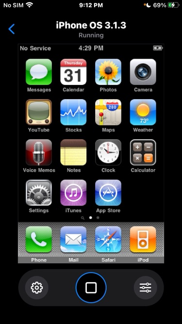
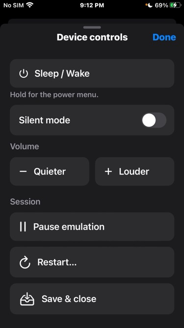
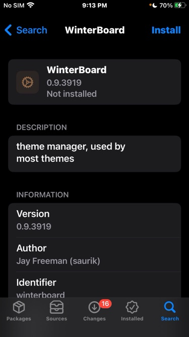

# S5LBox

**Classic iPhone OS. On your iPhone.**

Slide to unlock. Open an old favorite. Make it yours again.

S5LBox brings the iPhone 3G and its original iPhone OS 3.1.3 to your iPhone.
It's the real operating system, running inside an app—not a theme or a recreation.
Your iPhone doesn't need to be jailbroken.

[Download S5LBox](https://github.com/j0shua-SYSON/S5LBox/releases)

  
  
  

## What you can do

- **Rediscover the classics.** Explore the familiar Home screen, built-in apps,
  and compatible apps from the early days of iPhone.
- **Set up in a few taps.** Download iPhone OS inside S5LBox, or import your own
  firmware file. It checks and prepares everything for you—no keys to enter.
- **Bring your apps.** Import `.ipa` files directly or put them in S5LBox's
  **IPAs** folder in Files. Choose what to install, one app at a time, without
  closing the running machine.
- **Make room for tweaks.** Add Cydia and use the built-in **Packages** browser
  to explore sources, search, install, update, and remove packages. It handles
  required packages and tells you when a restart is needed.
- **Keep your own collection.** Create separate machines for different apps
  and experiments. Name them, keep their data separate, and let storage grow
  as you fill it. Smaller disks are available in **Advanced**.
- **Pick up where you left off.** Save and resume a session, or keep snapshots
  to return to later.
- **Stay in control.** Use Home, sleep, volume, and silent controls, pause when
  you need to, and connect your machine to the internet. Sound and microphone
  support are also available, though still experimental.

Everyday controls stay simple. Extra options—including the classic S5LBox
interface—live in **Advanced**.

## Get started

You'll need an iPhone running **iOS 13 or later** and several gigabytes
of free storage.

1. Download **S5LBox.ipa** from [Releases](https://github.com/j0shua-SYSON/S5LBox/releases)
   and install it with your preferred IPA installer.
2. Open S5LBox and tap **Download iPhone OS**. Already have the iPhone 3G's
   iPhone OS 3.1.3 firmware file? Choose **Import IPSW** instead.
3. Keep S5LBox open while setup finishes, then tap **Start iPhone OS**.

When you're done, choose **Save & close** to keep your place.
Firmware downloads come directly from Apple; Apple firmware is not included
with S5LBox.

## Good to know

This first release is experimental. Speed varies by device, and not every app,
tweak, or hardware feature works yet. Apps must be compatible with iPhone OS
3.1.3 and the iPhone 3G; copy-protected app files cannot be installed. Some apps
need AppSync installed inside the machine.

Keep a backup of anything important before experimenting.

## Learn more

- [Installing apps](docs/live-ipa-usb.md) · [Packages and tweaks](docs/native-package-manager.md)
- [Audio](docs/audio.md) · [Storage options](docs/DISK-SIZE-PRESETS.md)
- [Building and technical details](docs/README-DETAILED.md) · [Architecture](docs/ARCHITECTURE.md)
- [Report a problem](https://github.com/j0shua-SYSON/S5LBox/issues)

## License

[MIT](LICENSE). Created by [j0shua-SYSON](https://github.com/j0shua-SYSON).
The guest package helper includes Apple Csu code under
[APSL](app/Resources/GuestPackages/GuestPackageNotices.txt).
S5LBox is an independent project, not affiliated with or endorsed by Apple.
